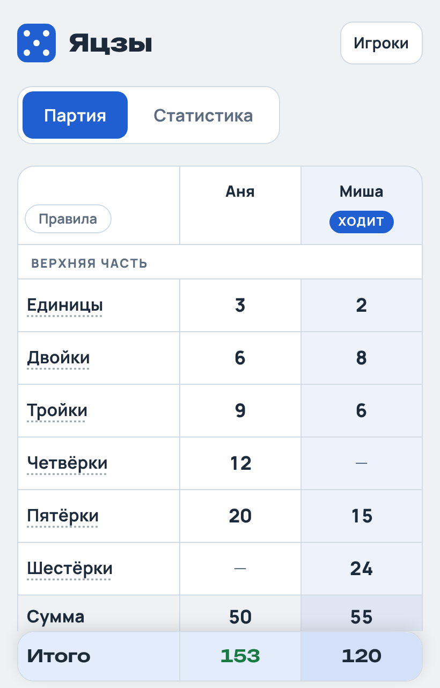
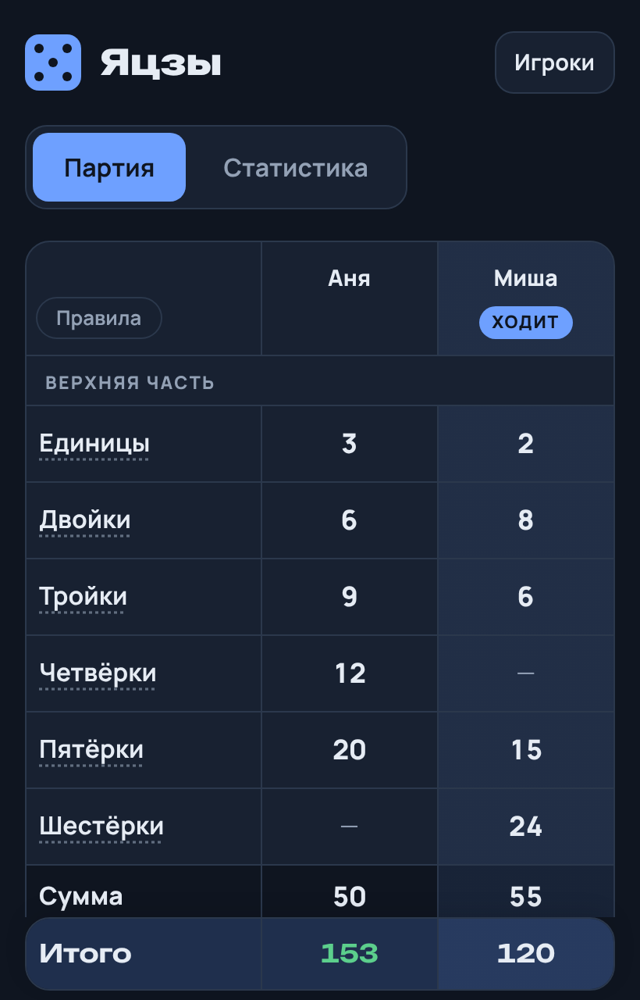
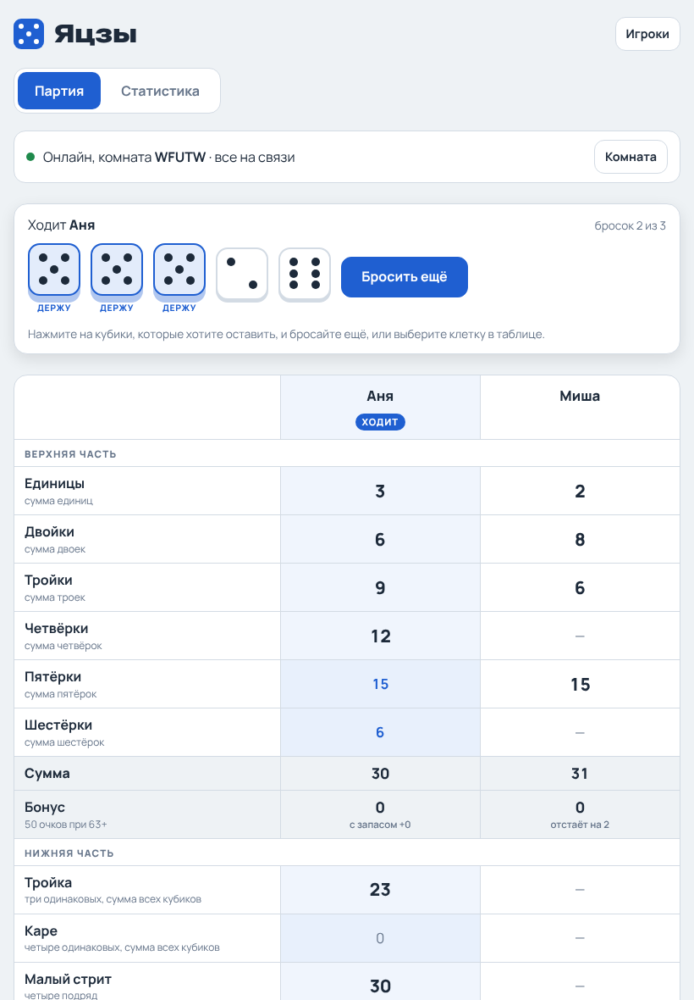
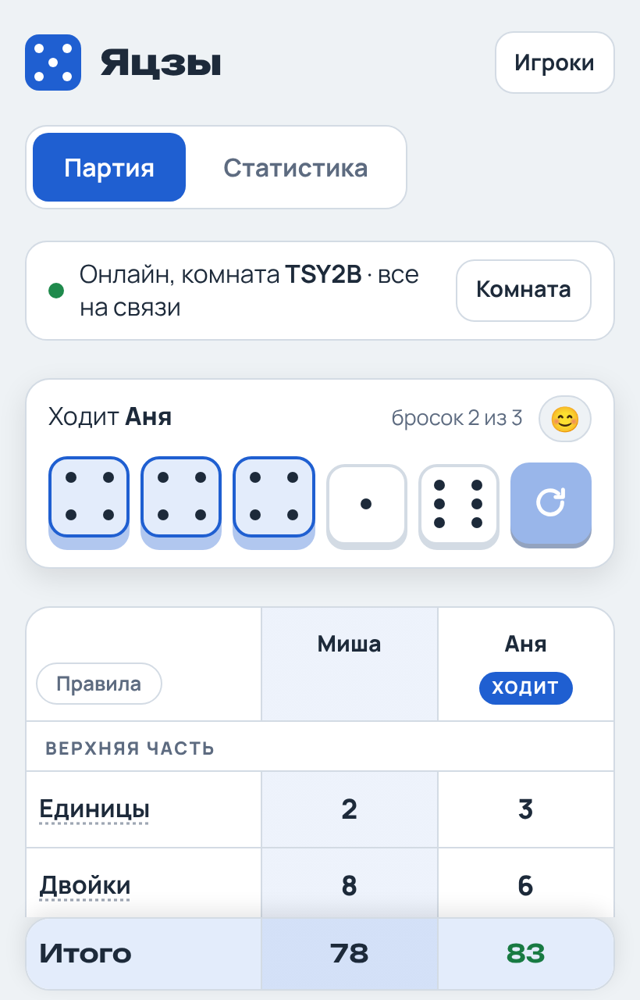
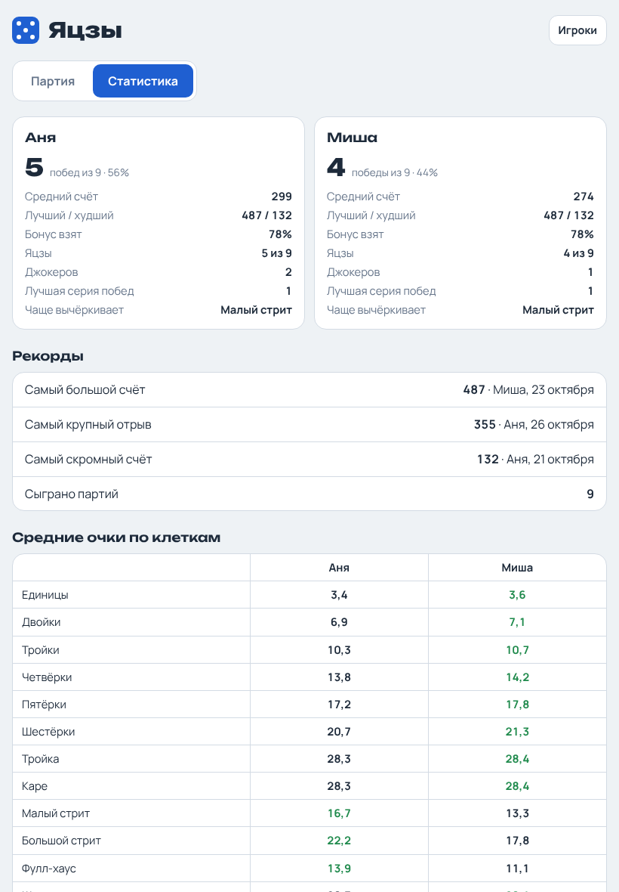
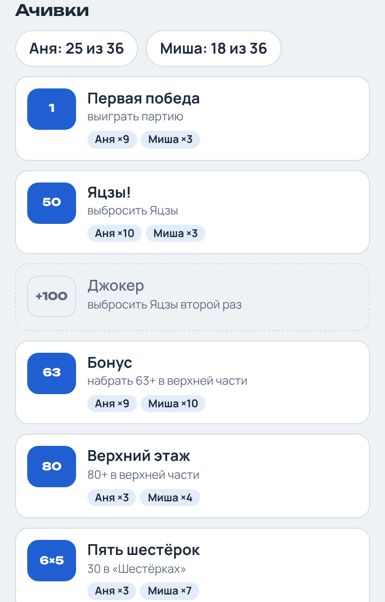
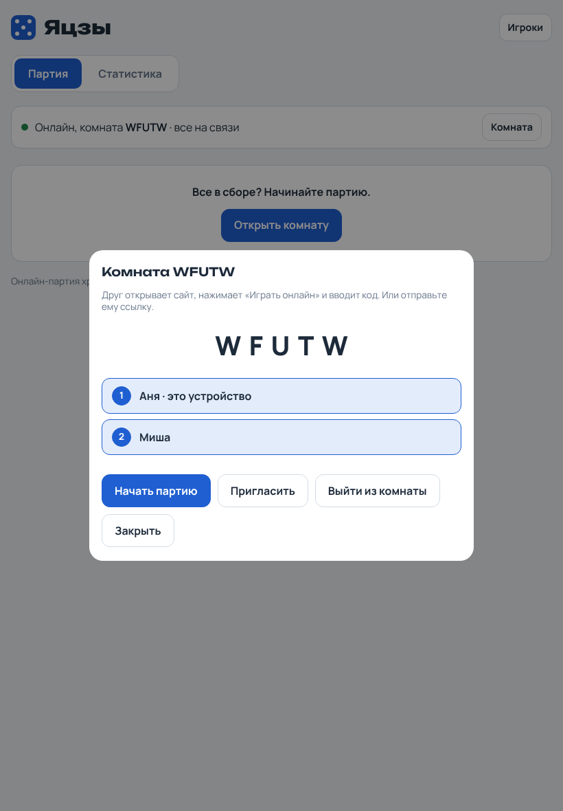

<p align="center">
  
</p>

<h1 align="center">Яцзы</h1>

<p align="center">
  Блокнот для подсчёта очков в Яцзы на iPad.<br>
  Работает в браузере, ставится на экран «Домой» и не требует интернета.<br>
  Можно играть с настоящими кубиками, с кубиками на экране или онлайн с другом.
</p>

<p align="center">
  <a href="https://kitoglav22.github.io/yatzy/"><b>Открыть блокнот →</b></a>
</p>

<p align="center">
  
  &nbsp;
  
</p>

## Что умеет

- **Удобный ввод.** Нажимаете на клетку, и появляются только те значения, которые в ней возможны. 0 значит вычеркнуть.
- **Кубики на экране**, если настоящих нет под рукой: до трёх бросков за ход, нажатием кубик откладывается, а в таблице сразу видно, сколько даст каждая клетка. Кубики честные: каждая грань выпадает с вероятностью ровно 1/6 (криптографический генератор браузера).
- **Игра онлайн.** Каждый играет на своём устройстве: создаёте комнату, отправляете другу код или ссылку, и у вас общая таблица. Бросает тот, чей ход, остальные видят каждый бросок и отложенные кубики. Можно сидеть вдвоём за одним iPad и играть против друга на другом. Партия попадает в историю и статистику у всех.
- **Всё считается само:** суммы, бонус за верхнюю часть, итог, чей сейчас ход.
- **Ошибки не страшны:** кнопка «Отменить» откатывает последний ход, даже после конца партии.
- **Экран не гаснет**, пока идёт партия.
- **Партию можно закончить досрочно**, а любую прошлую открыть целиком или удалить.
- **От 2 до 4 игроков** из сохранённого списка. Игроков можно переименовывать, а порядок хода менять прямо в партии.
- **Статистика:** победы и процент побед, средний и лучший счёт, как часто берётся бонус, серии побед, рекорды и средние очки по каждой клетке.
- **36 ачивок** с разбивкой по игрокам: у кого есть, у кого нет и сколько раз. Новые всплывают прямо во время партии.
- **Работает без интернета** (кроме онлайн-игры) и само обновляется, когда интернет появляется.
- **Резервная копия** истории и игроков в файл (в «Файлы» или iCloud Drive) и восстановление из него. Каждые 5 партий блокнот напоминает о копии.
- Светлая и тёмная тема подстраиваются под настройки устройства.

<p align="center">
  
  &nbsp;
  
</p>

<p align="center">
  
  &nbsp;
  
</p>

## Правила

Домашний вариант: основа взята из скандинавской Яцзы, нижняя часть ближе к американскому Yahtzee.

| Клетка | Очки |
|---|---|
| Единицы … Шестёрки | сумма кубиков с этим числом |
| Бонус | **50**, если в верхней части 63 и больше |
| Тройка | сумма всех кубиков, если есть три одинаковых |
| Каре | сумма всех кубиков, если есть четыре одинаковых |
| Малый стрит | **30** за четыре подряд |
| Большой стрит | **40** за пять подряд |
| Фулл-хаус | **25** за тройку и пару |
| Шанс | сумма всех кубиков |
| Яцзы | **50** за пять одинаковых |
| Джокер | **+100** за повторный Яцзы, один раз за игру. В другую свободную клетку при этом ставится 0 |

## Как играть онлайн

1. «Играть онлайн» → «Создать комнату» и отметить, кто играет на этом устройстве.
2. Отправить другу код из пяти символов или ссылку кнопкой «Пригласить».
3. Друг открывает ссылку или нажимает «Играть онлайн» и вводит код.
4. Когда все в комнате, «Начать партию». После конца партии «Ещё партию» начинает новую, первым ходит следующий игрок.

Текущая партия на устройстве при этом никуда не пропадает и возвращается после выхода из комнаты.

<p align="center">
  
</p>

## Как поставить на iPad

1. Откройте https://kitoglav22.github.io/yatzy/ в Safari.
2. Нажмите «Поделиться» → «На экран Домой».
3. Запускайте с иконки. Если нужно подтянуть обновление, закройте блокнот в переключателе приложений и откройте снова.

> Партии хранятся на самом устройстве. Наружу уходит только онлайн-партия: пока она идёт, имена и очки лежат в комнате на сервере Firebase, а когда все выходят, комната удаляется. Время от времени жмите «Сохранить копию» на вкладке «Статистика».
> Не удаляйте иконку с экрана «Домой»: вместе с ней iPadOS удаляет и сохранённые данные.

## Устройство

Одна HTML-страница без сборщиков. Внешние библиотеки, Firebase и скрипт Telegram, загружаются только там, где нужны: для онлайн-игры и внутри Telegram. Исходный код лежит здесь, в ветке `main`. После каждого изменения GitHub прогоняет тесты, и только если они прошли, собирает страницу и публикует её в ветку [`gh-pages`](https://github.com/kitoglav22/yatzy/tree/gh-pages), откуда её раздаёт GitHub Pages (`.github/workflows/site.yml`).

| Файл | Что это |
|---|---|
| `src/app.html` | каркас страницы: разметка и порядок частей |
| `src/style.css` | оформление, светлая и тёмная тема |
| `src/core.js` | правила, состояние партии, хранение, подсчёт сумм |
| `src/game.js` | таблица, ввод очков, игроки, прошлые партии, вкладки |
| `src/dice.js` | кубики на экране, подсказки очков, анимация броска |
| `src/achievements.js` | ачивки, всплывающие уведомления, статистика |
| `src/offline.js`, `src/backup.html` | резервная копия и работа без интернета |
| `src/online.js` | онлайн-комнаты через Firebase Realtime Database |
| `src/telegram.js` | режим мини-приложения Telegram: тема, кнопка «Назад», вибрация, приглашения через бота |
| `database.rules.json` | правила доступа к базе: только комнаты по коду, с проверкой размера |
| `build.py` | собирает всё в один `index.html` |
| `sw.js` | кэш для работы без интернета |
| `tests/` | тесты в браузере: правила, партия, кубики, копия, онлайн |

Чтобы поменять правила или ачивки, правьте `src/core.js` (массивы `UP`, `LOW`, `JK`) или `src/achievements.js` (`ACH`), затем увеличьте номер кэша в `sw.js`. Собирать страницу вручную не нужно: это делает GitHub после тестов. Локально её собирает `python3 build.py`.

## Тесты

```
npm install
npx playwright install chromium
npm test
```

`npm test` собирает страницу и проверяет её в браузере без экрана: подсчёт очков по домашним правилам, конец партии и отмену, досрочное завершение, ачивки, резервную копию, кубики с джокером и онлайн-игру на нескольких устройствах. Онлайн и Telegram проверяются на подменах, настоящие Firebase и Telegram в тестах не нужны.
